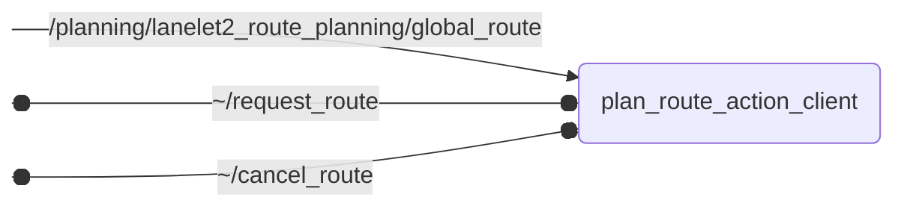

# `plan_route_action_client`

Action client to plan routes through route request services

- [Nodes](#nodes)
  - [plan_route_action_client](#plan_route_action_client)

## Services

| Type | Description |
| --- | --- |
| [`plan_route_action_client/srv/RequestRoute`](srv/RequestRoute.srv) | Requests waypoint, loop, random, or continuous random planning. |


## Nodes

### `plan_route_action_client`

The `plan_route_action_client` node is an action client interacting with the `lanelet2_route_planning` action server. It supports waypoint and random route planning:

1. waypoints: follows WGS84 waypoints. Wait times: `-1` passes without stopping, `0` stops without extra waiting, and `>0` waits that many seconds after confirmed arrival. Continuous planning preserves stops and waits before looping.
2. random: plans to a random destination on the map.

Waypoint requests require matching WGS84 `waypoints` and `wait_times`; random modes need neither. Active requests, including waits and loops, reject new requests until completion or explicit cancellation. Responses include `accepted` (request) or `success` (Trigger), plus `message`.

The client starts idle. Both parameters are loaded at startup; the replanning proportion can also be changed through ROS parameters.

**CLI examples**

<details>
<summary>Plan a route to one waypoint</summary>

Plan once to the specified destination with no extra wait at arrival.

```bash
ros2 service call /plan_route_action_client/request_route plan_route_action_client/srv/RequestRoute \
  '{mode: 0, waypoints: [{latitude: 50.787801, longitude: 6.046555, altitude: 0.0}], wait_times: [0.0]}'
```

</details>

<details>
<summary>Plan a route to a random destination</summary>

```bash
ros2 service call /plan_route_action_client/request_route plan_route_action_client/srv/RequestRoute \
  '{mode: 2}'
```

</details>

<details>
<summary>Cancel the current route</summary>

Stops automatic planning and requests cancellation of the client's active goals. An accepted cancellation may still be in progress when the service replies.

```bash
ros2 service call /plan_route_action_client/cancel_route std_srvs/srv/Trigger '{}'
```

</details>

<details>
<summary>Repeat a waypoint route</summary>

```bash
ros2 service call /plan_route_action_client/request_route plan_route_action_client/srv/RequestRoute \
  '{
    mode: 1,
    waypoints: [
      {latitude: 50.787524, longitude: 6.050095, altitude: 0.0},
      {latitude: 50.779794, longitude: 6.050634, altitude: 0.0},
      {latitude: 50.784935, longitude: 6.043669, altitude: 0.0},
      {latitude: 50.787801, longitude: 6.046555, altitude: 0.0}
    ],
    wait_times: [-1.0, -1.0, 0.0, 5.0]
  }'
```

The route passes through waypoints 1 and 2, stops at waypoint 3 without an extra wait, and waits five seconds at waypoint 4 before repeating. Where applicable, the default replanning threshold is 60% route progress. Replanning preserves stops and wait times.

</details>



#### Subscribed Topics

| Topic | Type | Description |
| --- | --- | --- |
| `/planning/lanelet2_route_planning/global_route` | `route_planning_msgs/msg/Route` | complete route used to detect passed waypoints |

#### Service Servers

| Service | Type | Description |
| --- | --- | --- |
| `~/request_route` | `srv/RequestRoute` | Supports `MODE_ROUTE` (0), `MODE_LOOP` (1), `MODE_RANDOM` (2), and `MODE_RANDOM_CONTINUOUS` (3). |
| `~/cancel_route` | `std_srvs/srv/Trigger` | Stops automatic planning and asynchronously cancels this client's goals. |

#### Action Clients

| Action | Type | Description |
| --- | --- | --- |
| `/planning/lanelet2_route_planning/plan_route` | `route_planning_msgs/action/PlanRoute` | plans route to destination |

#### Parameters

| Parameter | Type | Default | Description |
| --- | --- | --- | --- |
| `ll2_map_server_name` | `string` | `"ll2_map_server"` | Name of lanelet2_map_server node |
| `continuous_planning_replanning_proportion` | `float` | `0.6` | Traveled route proportion at which continuous waypoint replanning starts |
