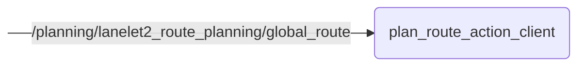

# `plan_route_action_client`

Action client using `route_planning_msgs/action/PlanRoute`, controlled through route request services

- [Nodes](#nodes)
  - [plan_route_action_client](#plan_route_action_client)

## Nodes

### `plan_route_action_client`

The `plan_route_action_client` node is an action client interacting with the `lanelet2_route_planning` action server. It supports waypoint and random route planning:

1. waypoints: plans routes to pre-defined waypoints, one after the other; `WAIT_TIME_S = -1` marks intermediate waypoints without a stop, `0` marks a destination with a stop and no additional wait, and positive values add a wait after confirmed arrival. Continuous planning may remove passed intermediate waypoints while retaining the current destination; the route loops only after each destination has been reached and its wait time has elapsed.
2. random: plans a route to a random destination on the map



#### Subscribed Topics

| Topic | Type | Description |
| --- | --- | --- |
| `/planning/lanelet2_route_planning/global_route` | `route_planning_msgs/msg/Route` | complete route used to detect passed waypoints |

#### Action Clients

| Action | Type | Description |
| --- | --- | --- |
| `/planning/lanelet2_route_planning/plan_route` | `route_planning_msgs/action/PlanRoute` | plans route to destination |

#### Services

| Service | Type | Description |
| --- | --- | --- |
| `~/request_route` | `plan_route_action_client/srv/RequestRoute` | Supports `MODE_ROUTE` (0), `MODE_LOOP` (1), `MODE_RANDOM` (2), and `MODE_RANDOM_CONTINUOUS` (3). |
| `~/get_route_status` | `std_srvs/srv/Trigger` | Returns the current request status in `message`; `success` indicates that the query succeeded. |
| `~/cancel_route` | `std_srvs/srv/Trigger` | Disables automatic planning, clears route state, and requests cancellation of this client's goals. |

Waypoint modes require WGS84 `waypoints` and matching `wait_times` directly in the request; random modes require no waypoints. New requests are rejected while a request is active, including waypoint waits and continuous planning. Explicitly cancel the current request or wait for completion before submitting another one. Route responses report `accepted`; cancellation responses report `success`. Both include a `message`; action execution and cancellation are asynchronous. After explicit cancellation, new requests are allowed immediately; old action callbacks cannot reactivate the canceled request.

Query the request status with:

```bash
ros2 service call /plan_route_action_client/get_route_status std_srvs/srv/Trigger "{}"
```

Status values: `IDLE`, `PLANNING` (including automatic retries), `SENDING`, `RUNNING`, `WAITING`, `SUCCEEDED`, `FAILED`, `CANCELED`. The terminal status is retained until the next accepted request or explicit cancellation; loop and continuous random requests remain active until canceled or stopped by an error.

#### Parameters

The client starts idle and plans only after a service request. The two application parameters below are loaded at startup; the replanning proportion can also be updated through ROS parameters and is never supplied by a route service request.

| Parameter | Type | Default | Description |
| --- | --- | --- | --- |
| `ll2_map_server_name` | `string` | `"ll2_map_server"` | Name of lanelet2_map_server node |
| `continuous_planning_replanning_proportion` | `float` | `0.6` | Traveled route proportion at which continuous waypoint replanning starts |
