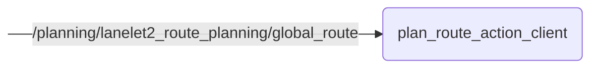

# `plan_route_action_client`

Action client using `route_planning_msgs/action/PlanRoute`, controlled through route request services

- [Nodes](#nodes)
  - [plan_route_action_client](#plan_route_action_client)

## Nodes

### `plan_route_action_client`

The `plan_route_action_client` node is an action client interacting with the `lanelet2_route_planning` action server. It supports waypoint and random route planning:

1. waypoints: follows WGS84 waypoints. Wait times: `-1` passes without stopping, `0` stops without extra waiting, and `>0` waits that many seconds after confirmed arrival. Continuous planning preserves stops and waits before looping.
2. random: plans to a random destination on the map.

#### Subscribed Topics

| Topic | Type | Description |
| --- | --- | --- |
| `/planning/lanelet2_route_planning/global_route` | `route_planning_msgs/msg/Route` | complete route used to detect passed waypoints |

#### Action Clients

| Action | Type | Description |
| --- | --- | --- |
| `/planning/lanelet2_route_planning/plan_route` | `route_planning_msgs/action/PlanRoute` | plans route to destination |

#### Services

| Service | Type | Description |
| --- | --- | --- |
| `~/request_route` | `plan_route_action_client/srv/RequestRoute` | Supports `MODE_ROUTE` (0), `MODE_LOOP` (1), `MODE_RANDOM` (2), and `MODE_RANDOM_CONTINUOUS` (3). |
| `~/get_route_status` | `std_srvs/srv/Trigger` | Returns status and available route details in `message`. |
| `~/cancel_route` | `std_srvs/srv/Trigger` | Stops automatic planning and asynchronously cancels this client's goals. |

Waypoint requests require matching WGS84 `waypoints` and `wait_times`; random modes need neither. Active requests, including waits and loops, reject new requests until completion or explicit cancellation. Responses include `accepted` (request) or `success` (Trigger), plus `message`.

Status messages use `key=value` fields for state, activity, mode, 1-based waypoints, remaining wait, and available feedback/result data. Progress refers to the current action goal. Missing feedback is marked unavailable; cancellation clears cached data.

States: `IDLE`, `PLANNING`, `SENDING`, `RUNNING`, `WAITING`, `SUCCEEDED`, `FAILED`, `CANCELED`. Terminal states remain until the next accepted request or cancellation.

#### Parameters

The client starts idle. Both parameters are loaded at startup; the replanning proportion can also be changed through ROS parameters.

| Parameter | Type | Default | Description |
| --- | --- | --- | --- |
| `ll2_map_server_name` | `string` | `"ll2_map_server"` | Name of lanelet2_map_server node |
| `continuous_planning_replanning_proportion` | `float` | `0.6` | Traveled route proportion at which continuous waypoint replanning starts |
